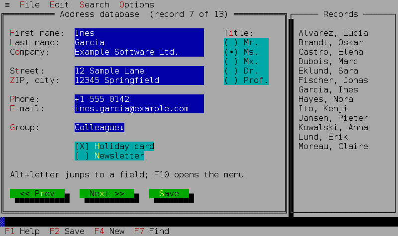
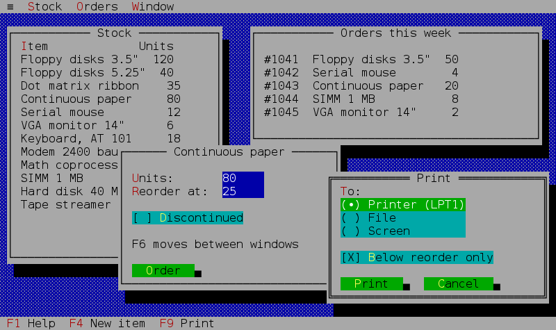
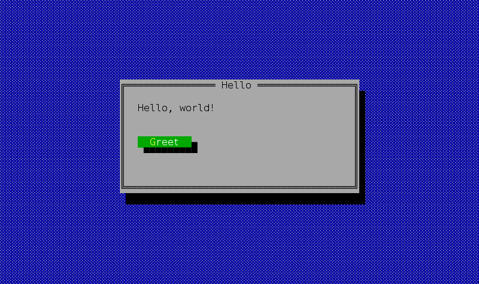
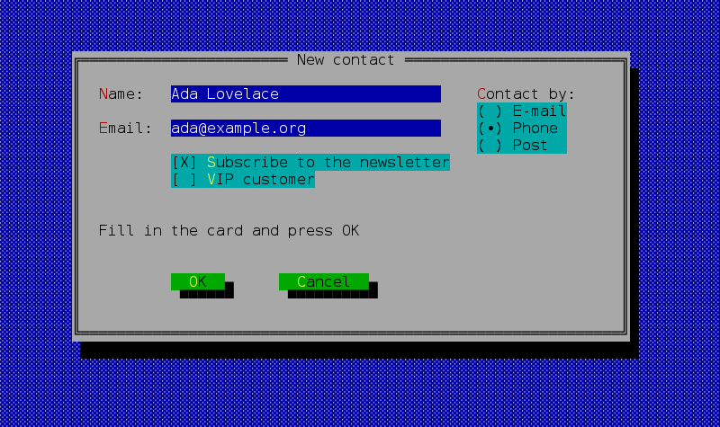
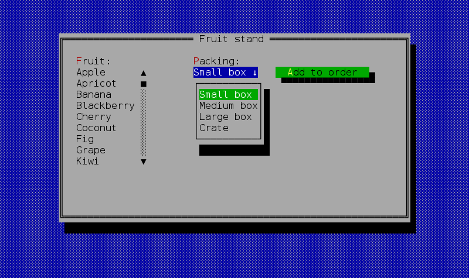
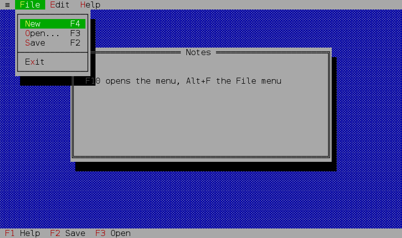
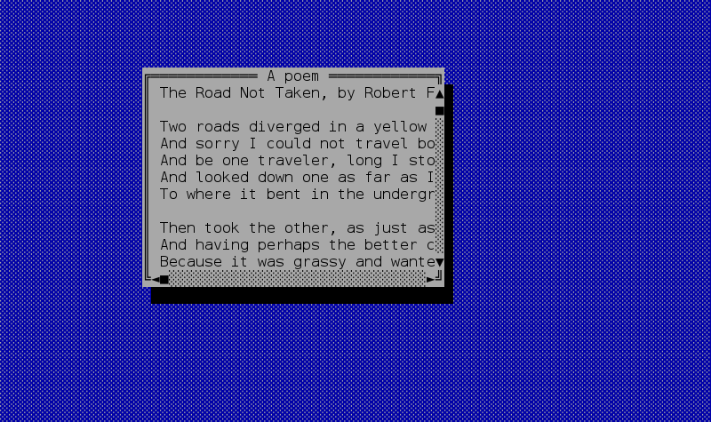
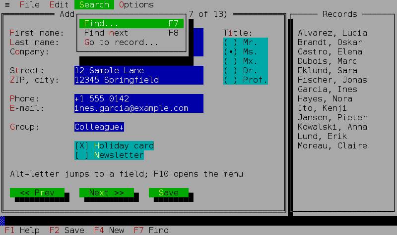

# chuin

**A Turbo Vision–style text user interface toolkit for Java.**

Windows with double-line frames and drop shadows, a menu bar, a status line of hot keys, buttons that press down,
check boxes, option groups, list boxes, drop downs and scroll bars. All of it is drawn with box-drawing characters in
the classic DOS palette, and it works with the keyboard and the mouse in any ANSI terminal.





The whole toolkit is built with strict outside-in TDD, under the design gate of
cerco ([how it is built](#how-it-is-built)): every interface was proposed and signed before it was written.

## Features

- **Windows**: framed, titled, overlapping, with shadows. You can move them by their title, resize them from the
  bottom-right corner, raise them with a click, and cycle through them with F6. Ctrl+W closes one.
- **Views**: labels, input lines, buttons (pressed with Enter, Space, a hot key or a click), check boxes, option
  groups, list boxes with a scroll bar, and drop downs whose list opens under them.
- **Hot keys everywhere**: in a caption like `"~S~ave"`, the letter between tildes is highlighted. Alt+S reaches the
  view, and a label linked to a view hands the focus to it.
- **Menus**: a menu bar with drop-down menus, separators, and items that show their shortcut key. You open it with
  F10, Alt+letter or a click.
- **Status line**: entries like `~F2~ Save` that run their command from anywhere.
- **Scrolling**: when a window is smaller than its contents, scroll bars appear on its frame. You can use the arrows,
  the track or the thumb, drag the thumb, or just move the focus.
- **Mouse**: click, drag and release through the terminal's mouse reporting (SGR 1006).
- **Colour**: exact 24-bit DOS colours when `COLORTERM` is `truecolor` or `24bit`, and the 16 named colours otherwise.
- **Testable**: a screen is plain text plus one tint letter per cell, so a test can assert exactly what is drawn.

## Requirements

- Java 21 or later
- Maven 3.9 or later
- The `cerco-maven-plugin` (`com.fpetrola:cerco-maven-plugin:0.30.0`) available to Maven. It runs as part of the build.

## Running the demos

```sh
./demo.sh                 # the address book
./demo.sh inventory       # several windows and a dialog
./demo.sh hello           # or: form, lists, menus, scrolling
```

`demo.sh` builds the project, puts the terminal in raw mode, and runs the example across the whole terminal.
Ctrl+Q quits and restores the terminal. For the exact DOS colours, run it with `COLORTERM=truecolor`.

The code of every example is in [`tui-demo/src/main/java/com/fpetrola/tui/demo`](tui-demo/src/main/java/com/fpetrola/tui/demo).

## Modules

| Module     | What it holds                                                                                        |
|------------|------------------------------------------------------------------------------------------------------|
| `tui-api`  | The interfaces an application is written against: `Toolkit`, `Desktop`, `Window`, the views, menus.   |
| `tui-text` | Their implementation for ANSI terminals: drawing, keyboard and mouse decoding, the palette.           |
| `tui-demo` | The examples and demos shown here, and the test that takes these screenshots.                         |

An application depends only on `tui-api`, plus `tui-text` for the single line that creates the toolkit.

## Quick start

Everything is made by a `Toolkit`. You build windows from views, open them on the desktop, and hand the desktop to a
console:

```java
Toolkit toolkit = new TextToolkit();
Desktop desktop = toolkit.desktop();

Window window = toolkit.window("Hello");
window.place(toolkit.area(20, 7, 40, 10));          // column, row, columns, rows: frame included
Label greeting = toolkit.label("Hello, world!");
Button greet = toolkit.button("~G~reet");           // Alt+G presses it
greet.onPress(pressed -> greeting.text("Hello again, world!"));
window.add(greeting, toolkit.point(2, 1));          // positions are inside the frame
window.add(greet, toolkit.point(2, 4));
desktop.open(window);

Screen screen = toolkit.screen(80, 25);
toolkit.console(System.in, System.out, screen).run(desktop);
```



The console reads keys and mouse events until its input ends, and redraws after each one. The terminal must be in raw
mode, as `demo.sh` sets it (`stty -icanon -echo -icrnl -ixon`).

## Examples

### A form

Input lines with their labels, check boxes, a group of options and buttons. A label made with
`toolkit.label(caption, view)` takes its hot key to that view.

```java
Window dialog = toolkit.window("New contact");
dialog.place(toolkit.area(8, 3, 62, 17));

InputLine name = toolkit.inputLine(30);
dialog.add(toolkit.label("~N~ame:", name), toolkit.point(2, 1));
dialog.add(name, toolkit.point(10, 1));

CheckBox subscribe = toolkit.checkBox("~S~ubscribe to the newsletter");
subscribe.toggle();
dialog.add(subscribe, toolkit.point(10, 5));

OptionGroup contact = toolkit.optionGroup(List.of("E-mail", "Phone", "Post"));
dialog.add(toolkit.label("~C~ontact by:", contact), toolkit.point(44, 1));
dialog.add(contact, toolkit.point(44, 2));

Label said = toolkit.label("Fill in the card and press OK");
Button ok = toolkit.button("~O~K");
ok.onPress(pressed -> said.text("Saved " + name.text()));
dialog.add(said, toolkit.point(2, 9));
dialog.add(ok, toolkit.point(10, 12));
```



Source: [`FormControls.java`](tui-demo/src/main/java/com/fpetrola/tui/demo/FormControls.java)

### Lists and drop downs

A list box shows a fixed number of rows, with a scroll bar beside them. A drop down shows the chosen item, and its
list opens under it with ↓ or a click, and Enter chooses.

```java
ListBox fruit = toolkit.listBox(List.of("Apple", "Apricot", "Banana", /* ... */ "Plum"), 9);
DropDown size = toolkit.dropDown(List.of("Small box", "Medium box", "Large box", "Crate"));
Label order = toolkit.label("");
Button add = toolkit.button("~A~dd to order");
add.onPress(pressed -> order.text(size.chosen().orElse("") + " of " + fruit.selected().orElse("")));

window.add(toolkit.label("~F~ruit:", fruit), toolkit.point(2, 1));
window.add(fruit, toolkit.point(2, 2));
window.add(toolkit.label("~P~acking:", size), toolkit.point(22, 1));
window.add(size, toolkit.point(22, 2));
```



Source: [`ListsAndDropDowns.java`](tui-demo/src/main/java/com/fpetrola/tui/demo/ListsAndDropDowns.java)

### Menus and the status line

When a menu item is given a key, the item shows it and the key runs the item from anywhere. Status line entries work
the same way.

```java
MenuBar bar = toolkit.menuBar();
Menu file = toolkit.menu("~F~ile");
file.add("~N~ew", toolkit.functionKey(4), () -> said.text("New note"));
file.add("~O~pen...", toolkit.functionKey(3), () -> said.text("Open a note"));
file.add("~S~ave", toolkit.functionKey(2), () -> said.text("Note saved"));
file.separator();
file.add("E~x~it", () -> said.text("Ctrl+Q quits"));
bar.add(toolkit.menu("≡"));
bar.add(file);

StatusLine status = toolkit.statusLine();
status.add("~F1~ Help", toolkit.functionKey(1), () -> said.text("Tab, Alt+letter, F10, Esc"));
status.add("~F2~ Save", toolkit.functionKey(2), () -> said.text("Note saved"));

desktop.show(bar);
desktop.show(status);
```



Source: [`MenusAndStatusLine.java`](tui-demo/src/main/java/com/fpetrola/tui/demo/MenusAndStatusLine.java)

> A key bound on the status line or with `desktop.bind(key, command)` wins over what the key did before, F10 included.

### A window that scrolls

Nothing needs to be declared. When a window's views reach past its frame, scroll bars appear on the frame, and the
window scrolls to keep the focused view in sight.

```java
Window window = toolkit.window("A poem");
window.place(toolkit.area(16, 4, 34, 13));
for (int line = 0; line < poem.size(); line++) {
  window.add(toolkit.label(poem.get(line)), toolkit.point(1, line));
}
```



Source: [`ScrollingWindow.java`](tui-demo/src/main/java/com/fpetrola/tui/demo/ScrollingWindow.java)

For a scrolling area inside a window, `toolkit.scrollPanel(view, columns, rows)` wraps any view in a panel with its
own bars.

### The address book

A record card in the style of the DOS database programs of the early nineties: labelled fields, a group of options,
check boxes, a drop down and buttons, next to a list of records, under a full menu bar.



Source: [`AddressBook.java`](tui-demo/src/main/java/com/fpetrola/tui/demo/AddressBook.java),
[`Inventory.java`](tui-demo/src/main/java/com/fpetrola/tui/demo/Inventory.java)

## Keys and mouse

| Key                  | What it does                                                  |
|----------------------|---------------------------------------------------------------|
| Tab                  | Moves the focus to the next view of the window                 |
| Alt+letter           | Goes to the view whose highlighted letter it is, or opens that menu |
| Enter / Space        | Presses the focused button; Space toggles a check box          |
| ↑ ↓                  | Move through a list, a group of options or an open menu        |
| ↓ on a drop down     | Opens its list; Enter chooses the item, Esc closes it          |
| F10                  | Opens the menu bar; Esc closes it                              |
| F6                   | Raises the next window                                         |
| Ctrl+W               | Closes the top window                                          |
| Ctrl+Q               | Quits (in `demo.sh`)                                           |

With the mouse you can click any view to focus it or press it, click a menu title or a status entry, drag a window by
its title or from its bottom-right corner, and click or drag a scroll bar.

## Testing a user interface

A `Screen` is just text: `lines()` gives what each row shows, and `tints()` gives one letter per cell saying how the
cell is coloured. That makes the whole UI testable without a terminal:

```java
Toolkit toolkit = new TextToolkit();
Desktop desktop = toolkit.desktop();
new HelloWorld().build(toolkit, desktop);

Screen screen = toolkit.screen(80, 25);
desktop.draw(screen);

assertTrue(screen.lines().get(9).contains("Hello, world!"));
```

The screenshots in this README are made this way, by
[`TakingScreenshotsTest`](tui-demo/src/test/java/com/fpetrola/tui/demo/TakingScreenshotsTest.java). To take them
again:

```sh
mvn -pl tui-demo -am test -Dtest=TakingScreenshotsTest -Dsurefire.failIfNoSpecifiedTests=false \
    -Dscreenshots=$PWD/docs/screenshots
```

## How it is built

The project is written test-first, from the outside in: each feature starts as a test of what the user sees.

It also exercises cerco, a Maven plugin that seals a module's interfaces. A new public
member, or an interface that grows, is written up as a proposal (the need, what was considered, and the test that
says what it promises), and a person signs it with `mvn cerco:approve` before the code can go in. cerco also checks
the code for conditional chains, clones, casts, constant holders and package cycles. The signed proposals are kept in
`.cerco/surface/signed`.

- [`DECISIONS.md`](DECISIONS.md) records every design decision and why it was made.
- [`PLAN.md`](PLAN.md) holds the plan and what is left of it.
